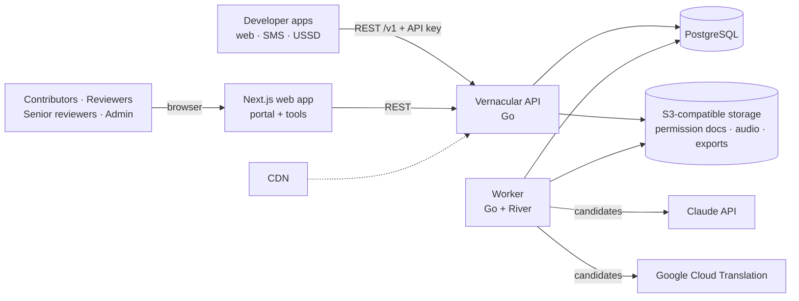
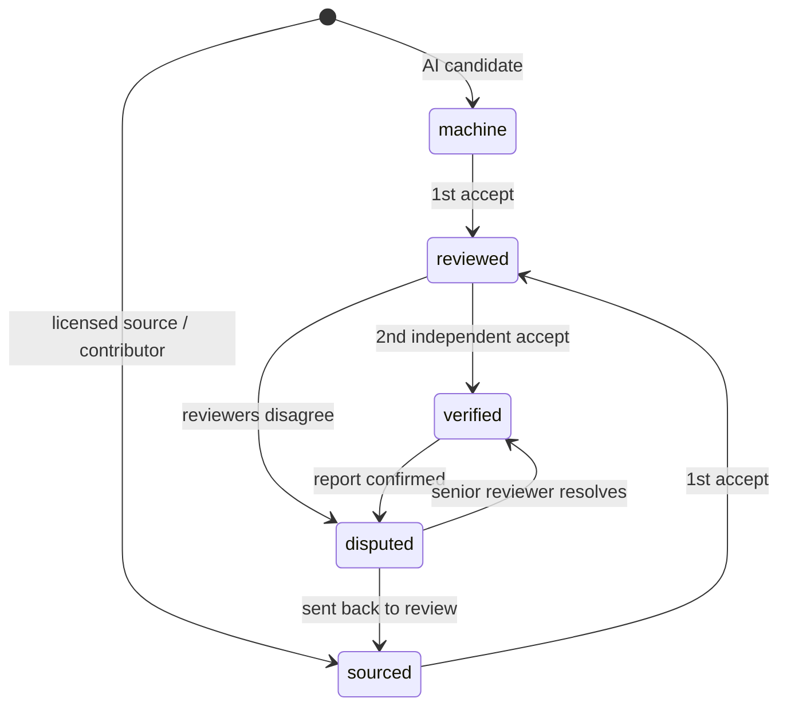
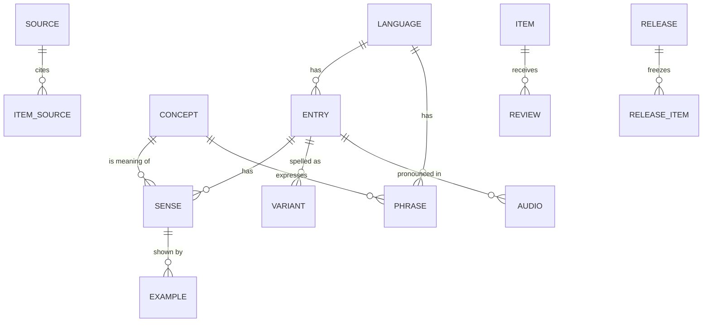
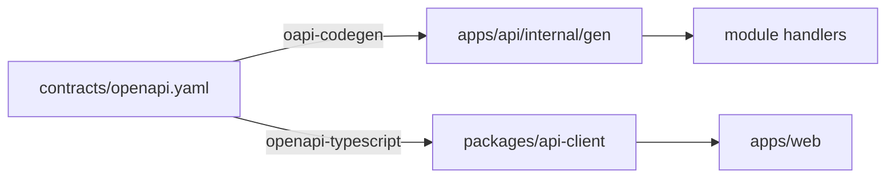

# Architecture

This document turns §9 and §10 of [requirements.md](requirements.md) into structure the code follows. Decisions with lasting trade-offs live in [adr/](adr/).

## 1. Shape of the system

The system is a data pipeline with a human review step in the middle and a read-heavy API at the end. Data enters from licensed sources, contributors or AI candidate jobs. All of it lands in the same review queue, and only the verified store feeds lookups by default.

We start as **one Go service (a modular monolith)**, one background worker and one Next.js app, over one PostgreSQL database. A module moves into its own service only when load or team size demands it ([ADR-0002](adr/0002-go-modular-monolith.md)).

## 2. Context



## 3. Containers

| Container           | Path                            | Responsibility                                                                                                     |
| ------------------- | ------------------------------- | ------------------------------------------------------------------------------------------------------------------ |
| API                 | `apps/api/cmd/api`              | Public `/v1` read endpoints, plus the internal endpoints the web tools use. Handles keys, rate limits and caching. |
| Worker              | `apps/api/cmd/worker`           | River jobs: AI candidate generation, agreement scoring, release builds, quarterly re-check sampling.               |
| Ingest              | `apps/api/cmd/ingest` (Phase 1) | One parser per licensed source. Runs on demand.                                                                    |
| Web                 | `apps/web`                      | `(portal)` public developer portal and docs; `(tools)` signed-in contribute, review, disputes, sources and admin.  |
| Database            | PostgreSQL 17                   | Entries, concepts, reviews, audit log. Search uses full text and `pg_trgm`.                                        |
| Object storage      | S3-compatible                   | Permission documents, audio, release exports.                                                                      |
| Translation service | Phase 3                         | Fine-tuned model, deployed separately so it scales and fails on its own.                                           |

## 4. Repository layout

```
contracts/openapi.yaml     The API contract. Go server code and the TS client are generated from it.
apps/api/                  Go module
  cmd/<binary>/            Thin entrypoints: wire dependencies, start, nothing else
  internal/platform/       Cross-cutting code: config, logging, db, httpserver, errors
  internal/<module>/       One folder per domain module (see §5)
  internal/gen/            oapi-codegen output. Never edit by hand
  db/migrations/           goose SQL migrations, forward-only in production
  db/queries/              sqlc input; generated code lands in internal/<module>/dbgen
apps/web/                  Next.js App Router
  app/(portal)/            Public pages
  app/(tools)/             Signed-in pages
  components/ui/           shadcn/ui primitives, unchanged where possible
  features/<domain>/       Feature components, hooks and server actions
  lib/                     App-wide helpers (API client instance, env)
packages/api-client/       Generated types + typed fetch client, shared by web and future SDKs
packages/eslint-config/    Shared lint rules
packages/tsconfig/         Shared TS config bases
deploy/                    docker compose for local development
docs/                      Requirements, stories, architecture, ADRs, style guides
```

## 5. Backend modules

Each module owns its tables, queries and HTTP handlers. Inside a module, dependencies point one way only:

```
handler.go  →  service.go  →  store.go  →  dbgen (sqlc)
 (HTTP, generated     (rules,         (SQL access)
  strict interface)    no HTTP/SQL)
```

- **Handlers** implement the generated strict server interface for their operations. They map between API types and domain types, and nothing more.
- **Services** hold the business rules: verification promotion, blind review, agreement scoring. They depend on small interfaces, which makes them unit-testable without a database.
- **Stores** wrap sqlc queries and transactions.
- **Across modules**, code calls another module's service interface. It never reaches into another module's store or tables.
- **Shared code** moves to `internal/platform` on its _second_ use, not before.

| Module                | Owns                                                                                   | Phase |
| --------------------- | -------------------------------------------------------------------------------------- | ----- |
| `languages`           | languages, varieties, counts                                                           | S     |
| `items`               | `items`, `item_sources`: creating reviewable rows, the trust fields every item returns | 0     |
| `lexicon`             | concepts, entries, variants, senses, examples, search                                  | 1     |
| `phrases`             | phrase packs, exact-match translate                                                    | 1     |
| `detect`              | language identification                                                                | 1     |
| `review`              | queue, decisions, promotion, disputes, reviewer scores                                 | 1     |
| `sources`             | source register, ingestion, normaliser                                                 | 1     |
| `candidates`          | AI candidate jobs (Claude, Google Translate)                                           | 1     |
| `contributions`       | proposals from registered contributors                                                 | 1     |
| `accounts`            | users, roles, API keys, rate-limit plans                                               | 1     |
| `reports`             | user reports                                                                           | 1     |
| `releases`            | release builds and exports                                                             | 2     |
| `textnorm` (platform) | NFC, case and accent folding                                                           | 0–1   |

## 6. Trust model

Every item the API returns embeds one shared `Trust` schema ([ADR-0004](adr/0004-verification-levels.md)):

| `status`   | Meaning                                        | Served by default                |
| ---------- | ---------------------------------------------- | -------------------------------- |
| `verified` | Two independent approved reviewers accepted it | yes                              |
| `reviewed` | One accept, waiting for a second               | only on request                  |
| `sourced`  | From a licensed source, not yet reviewed       | only on request                  |
| `machine`  | Model output                                   | only on request, always labelled |
| `disputed` | Disagreement or an open report                 | never                            |

Promotion is a single function in `review/service.go` and is the only code path that can set `verified`. It is covered by table tests for every transition.



## 7. Data model

Concepts are the hub that links languages ([ADR-0005](adr/0005-concept-hub.md)).



`ITEM` is the `items` table: every reviewable row (entry, sense, example, phrase) shares its ID with an `items` row that holds the trust status ([ADR-0006](adr/0006-items-table.md)). AI candidates are items with status `machine`. Every table has `created_at` and `updated_at`, and the `track()` trigger writes a row to `audit_log` for each change (NFR-8). Search folding is the SQL function `fold()`.

## 8. Contract-first flow



Change the contract first, run `make gen`, then implement. CI fails if the generated code is out of date ([ADR-0003](adr/0003-openapi-first.md)).

## 9. Cross-cutting rules

| Concern     | Rule                                                                                                           |
| ----------- | -------------------------------------------------------------------------------------------------------------- |
| Text        | UTF-8, NFC on input and storage. Search folds case and accents unless asked otherwise (NFR-7).                 |
| Errors      | Every error body is `{code, message, docs_url}`, built in one place: `internal/platform/httpx`.                |
| Validation  | Every request is checked against the contract by middleware before a handler runs (`internal/server`).         |
| Storage     | Files go through `internal/platform/blob` (gocloud.dev): S3-compatible in production, a folder in development. |
| Config      | Environment variables only, parsed once at startup into a typed struct. Documented in `.env.example`.          |
| Logging     | `log/slog` JSON with a request ID on every line.                                                               |
| Security    | API keys hashed at rest, TLS at the edge, rate limits per key and per IP (NFR-5).                              |
| Versioning  | `/v1` in the path. Breaking changes get `/v2` and six months of overlap (NFR-4).                               |
| Caching     | `ETag` tied to the release number, gzip/br compression (NFR-3).                                                |
| Portability | Containers, PostgreSQL and S3-compatible storage only, so the system runs anywhere (§12 hosting decision).     |

## 10. Technology

| Need                      | Choice                                                      | Status               |
| ------------------------- | ----------------------------------------------------------- | -------------------- |
| HTTP routing              | chi                                                         | adopted              |
| DB driver                 | pgx v5                                                      | adopted              |
| Typed queries             | sqlc                                                        | adopted              |
| Migrations                | goose                                                       | adopted              |
| Contract → Go             | oapi-codegen (strict chi server)                            | adopted              |
| Background jobs           | River ([ADR-0009](adr/0009-river-and-claude-candidates.md)) | adopted              |
| Unicode                   | golang.org/x/text                                           | Phase 0              |
| Web                       | Next.js 16, Tailwind v4, shadcn/ui                          | adopted              |
| Contract → TS             | openapi-typescript + openapi-fetch                          | adopted              |
| Monorepo                  | pnpm workspaces + Turborepo                                 | adopted              |
| Auth                      | Better Auth ([ADR-0007](adr/0007-better-auth.md))           | adopted              |
| Docs site / API reference | Fumadocs or Nextra; Scalar                                  | evaluate (P0-ENG-09) |
| Language detection        | existing LID models first                                   | evaluate (P1-API-08) |
| Stemmers                  | none exist; written by us                                   | Phase 1              |
